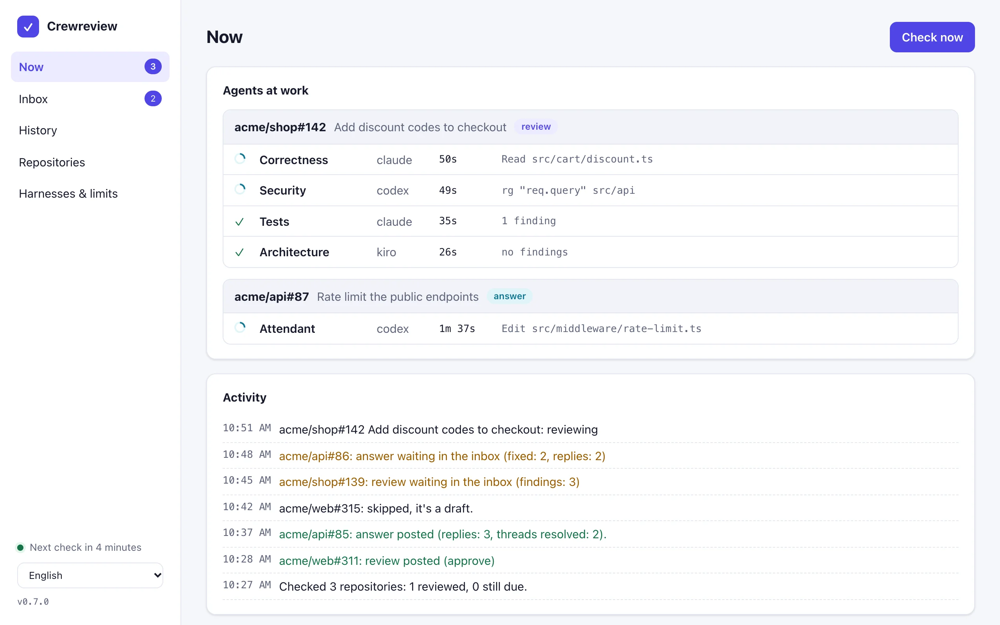
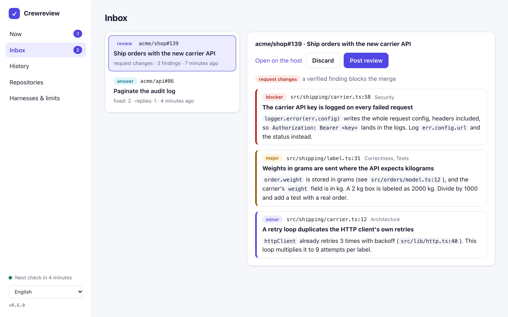
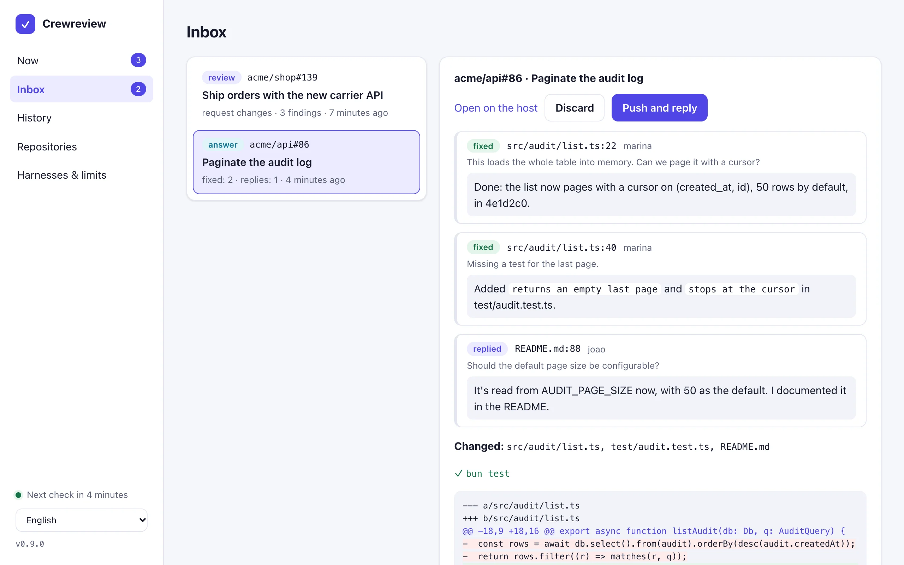
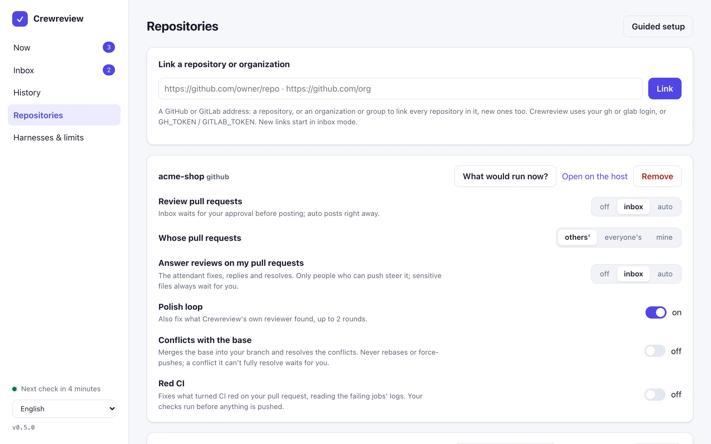

<p align="center">
  
</p>

<h1 align="center">Crewreview</h1>

<p align="center">
  <b>A crew of AI agents that reviews your team's pull requests and answers the reviews on yours.</b><br>
  Runs on your computer with the coding agents you already pay for: Claude Code, Codex, Kiro or any ACP agent.<br>
  GitHub and GitLab, cloud or self-managed. Free and open source. No server, no account, no telemetry.
</p>

<p align="center">
  <a href="https://github.com/Quost/crewreview/releases/latest"></a>
  
  <a href="https://github.com/Quost/crewreview/actions/workflows/ci.yml"></a>
  <a href="LICENSE"></a>
  <a href="https://github.com/Quost/crewreview/stargazers"></a>
</p>

<p align="center">
  <a href="https://crewreview.web.app/?ref=github"><b>Website</b></a> ·
  <a href="#install"><b>Download</b></a> ·
  <a href="https://crewreview.web.app/llms.txt"><b>Guide for AI agents</b></a> ·
  <a href="https://github.com/sponsors/Quost"><b>Sponsor</b></a>
</p>

<p align="center">
  <picture>
    <source media="(prefers-color-scheme: dark)" srcset="site/static/shots/en/now-dark.webp">
    
  </picture>
</p>

## Install

**The desktop app** is the easiest way: the dashboard in its own window, the inbox count in your menu bar or tray, a notification when something waits for you, and updates by itself.

| System | Download |
|---|---|
| macOS (Apple silicon) | [Crewreview-macos-arm64.dmg](https://github.com/Quost/crewreview/releases/latest/download/Crewreview-macos-arm64.dmg) |
| macOS (Intel) | [Crewreview-macos-x64.dmg](https://github.com/Quost/crewreview/releases/latest/download/Crewreview-macos-x64.dmg) |
| Windows 10+ (x64, and Arm through emulation) | [Crewreview-windows-x64-setup.exe](https://github.com/Quost/crewreview/releases/latest/download/Crewreview-windows-x64-setup.exe) |
| Linux x64 | [AppImage](https://github.com/Quost/crewreview/releases/latest/download/Crewreview-linux-x64.AppImage) · [.deb](https://github.com/Quost/crewreview/releases/latest/download/Crewreview-linux-x64.deb) · [.rpm](https://github.com/Quost/crewreview/releases/latest/download/Crewreview-linux-x64.rpm) |
| Linux arm64 | [AppImage](https://github.com/Quost/crewreview/releases/latest/download/Crewreview-linux-arm64.AppImage) · [.deb](https://github.com/Quost/crewreview/releases/latest/download/Crewreview-linux-arm64.deb) · [.rpm](https://github.com/Quost/crewreview/releases/latest/download/Crewreview-linux-arm64.rpm) |

The macOS app is signed and notarized. Windows may warn about an unknown publisher the first time: choose **More info**, then **Run anyway**.

**The command line** (`crewreview`), for terminals and servers:

```bash
curl -fsSL https://crewreview.web.app/install.sh | sh     # macOS, Linux

# or Homebrew: the formula lives in this repository, and recent Homebrew asks you to trust taps outside its own
brew tap Quost/crewreview https://github.com/Quost/crewreview
brew trust quost/crewreview
brew install Quost/crewreview/crewreview
```

```powershell
irm https://crewreview.web.app/install.ps1 | iex          # Windows (or Scoop: see below)
```

<details>
<summary><b>Let your AI assistant set it up</b>: a prompt for Claude Code, Codex or any agent</summary>

Paste this into your coding agent. It installs Crewreview, checks your setup, asks which repositories to watch and links them in inbox mode, so nothing is posted without you.

```text
Set up Crewreview for me. It's a free, open source crew of AI agents that reviews pull requests and answers the reviews on mine: https://github.com/Quost/crewreview. Its guide for agents: https://crewreview.web.app/llms.txt

1. Install the command line tool:
   - macOS or Linux: curl -fsSL https://crewreview.web.app/install.sh | sh (with Homebrew: brew tap Quost/crewreview https://github.com/Quost/crewreview && brew trust quost/crewreview && brew install Quost/crewreview/crewreview)
   - Windows, in PowerShell: irm https://crewreview.web.app/install.ps1 | iex
2. Run crewreview doctor. It needs git, at least one coding agent signed in (Claude Code, Codex or Kiro) and gh (GitHub) or glab (GitLab) signed in. If something is missing, tell me how to fix it and wait for me.
3. Ask me which repositories Crewreview should watch, or whether to link a whole organization or group. Link each in inbox mode, so nothing is posted without my approval: crewreview repo add <repository or organization URL> --attend inbox
4. Keep it running and open the dashboard: crewreview service install, then crewreview ui
5. Add Crewreview to the coding agents I use: crewreview mcp setup shows how for each one. In Claude Code: /plugin marketplace add Quost/crewreview, then /plugin install crewreview@crewreview

Explain each command before you run it. Never switch a repository to auto mode unless I ask.
```

</details>

<details>
<summary>Scoop, checksums and signatures</summary>

```powershell
scoop bucket add crewreview https://github.com/Quost/crewreview
scoop install crewreview/crewreview
```

The installers check each download against the release's `SHA256SUMS`, and its signature too when `minisign` is installed. To check by hand:

```bash
minisign -Vm SHA256SUMS -P RWTk8l0TkAFZQOxVkYWEHrU6Nj+j1UTCGOMps627c4qsvaX3fvRFzhpx
shasum -a 256 -c SHA256SUMS --ignore-missing
```

Builds are reproducible: the same commit and Bun version give the same bytes.

</details>

You'll need git, at least one coding agent signed in (Claude Code, Codex or Kiro) and `gh` or `glab` signed in. The first time you open the app or the dashboard, a setup page checks all of that, shows what a repository would start, and links it. From the terminal:

```bash
crewreview doctor                                      # what's installed and what each harness can do
crewreview repo add https://github.com/acme/shop       # starts in inbox mode: nothing is posted without you
# or a whole organization or group: crewreview repo add https://github.com/acme
crewreview ui                                          # open the dashboard
```

The app and the command line are the same crew and share their settings: the app carries the command line inside it, and shows the crew your background service runs if there is one. Only one crew runs per computer.

## What it does

### 🔍 Reviews your teammates' pull requests

<p align="center">
  <picture>
    <source media="(prefers-color-scheme: dark)" srcset="site/static/shots/en/inbox-dark.webp">
    
  </picture>
</p>

Several read-only lenses look at the change in parallel: correctness, security, architecture, tests and UI, plus any your repository adds. A verifier, from another vendor if you like, tries to prove each finding wrong. Findings that don't point at a real file and line are dropped, and a fixed rule (not a model) decides the verdict: request changes, comment or approve. It reads the description, the discussion so far, CI and what changed since its last review, and never repeats a point already made. One review, with inline comments, from your account.

### 🛠️ Answers the reviews on yours

<p align="center">
  <picture>
    <source media="(prefers-color-scheme: dark)" srcset="site/static/shots/en/fix-dark.webp">
    
  </picture>
</p>

On your own pull requests, the attendant reads each new review comment and decides: fixed, replied, declined, or left to you. It works in its own worktree (never in your clone), runs your checks, commits with your identity and signature, pushes without force, replies, resolves the threads it fixed and asks the reviewer to look again. The **polish loop** goes further: review, fix, review again, before you ask a person.

### 👀 Shows you everything, and waits for you

<p align="center">
  <picture>
    <source media="(prefers-color-scheme: dark)" srcset="site/static/shots/en/repos-dark.webp">
    
  </picture>
</p>

Every repository starts in **inbox** mode: reviews and answers wait for your approval in the dashboard or with `crewreview inbox`. Switch each one to **auto** when you trust it, one repository at a time. The dashboard shows every agent at work live, the inbox, history, and which harnesses are installed and proven safe, with today's usage. Five languages (English, Português, Español, Deutsch, 简体中文), light or dark.

## Use it with your team

- **Your team's rules live in the repository.** `.crewreview/lenses/<lens>.md` replaces a built-in lens or adds one, and the crew follows `AGENTS.md`, `CLAUDE.md` and `CONTRIBUTING.md`. All are read from the base branch, so a pull request can't change the rules it's judged by.
- **Everyone brings their own agent.** Each developer runs the crew with the coding agent plan they already have; reviews post from their own account. No seats, no shared API key, no server.
- **No duplicate reviews.** When several people run it on the same repository, a commit that already has a Crewreview review on the host is skipped, whoever's crew wrote it.
- **Link the whole organization at once.** `crewreview repo add https://github.com/acme` (or a GitLab group) links every repository in it, new ones too, with `--include`/`--exclude` name filters. One search per cycle finds the repositories with open pull requests, so even a large organization costs a few API calls. A repository linked on its own keeps its own settings.
- **GitHub and GitLab, cloud or self-managed**, with the `gh` or `glab` login you already have.
- **Comments in your team's language**, set per repository (`commentLanguage`), whatever language each person's dashboard is in.
- **Inbox first, auto when you trust it.** Nothing is posted or pushed without approval until you switch a repository to auto.
- **Or one bot for the whole team.** A Docker image runs the crew on a shared machine with a bot account, built from the signed release binary; you approve from your laptop over SSH. See [A shared team machine](docs/team-machine.md).

## Safe by design

Pull request text is written by others, and agents can be talked into things. Crewreview assumes both.

- **Read-only, proven.** Reviewers can't write or run commands. `crewreview doctor --conformance` proves it on your machine with a canary, per harness version; the attendant must also prove it can't write outside its worktree.
- **No tokens for agents.** Your git host token stays with Crewreview, and agents get a filtered environment. Crewreview does the committing, pushing and posting.
- **Only trusted voices.** Only people who can push to the repository (and bots you list) steer the attendant.
- **Sensitive files wait.** Changes to CI, secrets, deployment or the crew's own rules always wait for your approval, even in auto mode.
- **Nothing leaves but to your harness.** No server, no account, no telemetry.
- **Signed updates.** Updates install only with a valid signature from the release key built into your binary; the desktop app refuses an update whose signature names another version.

## Using the command line

### Review pull requests

Link a repository. Crewreview uses the login you already have in `gh` or `glab` (or `GH_TOKEN` / `GITLAB_TOKEN`):

```bash
crewreview repo add https://github.com/acme/shop            # new repositories start in inbox mode
crewreview repo add https://gitlab.com/acme/api --mode auto  # or post reviews right away
crewreview repo add https://github.com/acme --exclude "legacy-*"   # every repository of an organization or group
crewreview repo preview acme-shop                            # what would run now, before you switch to auto (changes nothing)
crewreview review acme-shop 42                               # review one pull request now
crewreview inbox                                             # what's waiting for you
crewreview inbox approve 3                                   # post it
crewreview run                                               # keep watching every linked repository
crewreview local                                             # review the current branch on this machine; nothing is posted
```

What it does for each pull request:

- Skips drafts, bots, your own pull requests (`--authors all` reviews them too), a `no-ai-review` label, commits it already reviewed, and pushes that only merged the base branch.
- Waits a few minutes for a series of pushes to settle, and for CI to finish.
- Fetches into its own mirror (your clones are never touched), reads the project rules from the base branch, the description, the discussion so far, CI, and what changed since its last review.
- Posts one review: inline comments on lines the diff shows, everything else in the summary. Hidden markers let it recognize its own comments later; points already made in the discussion aren't repeated.
- An approval needs `allowApprove = true`, no serious findings, green CI and a change under the size limit. On your own pull requests it only comments.

### Answer the reviews on your pull requests

```bash
crewreview repo set acme-shop --attend inbox      # or auto; off by default
crewreview attend acme-shop 42 --dry-run          # see what it would do, nothing saved or pushed
crewreview attend acme-shop 42                    # fix and draft the replies, wait in the inbox
crewreview inbox show f3                          # decisions, replies, diff, checks
crewreview inbox approve f3                       # push, reply, resolve, ask for a re-review
crewreview repo set acme-shop --conflicts on --ci on   # also fix conflicts with the base and red CI
```

- Only comments from people who can push to the repository (and bots you list, like Copilot) steer the agent.
- It waits until a review stops arriving, then works in a worktree of Crewreview's mirror, never in your clone.
- For each comment it decides: fixed, replied, declined, or needs you. "Fixed" with nothing changed counts as needs you.
- `validate = ["bun install", "bun test"]` in `[repo.attend]` runs your checks before anything is pushed; if they fail, the agent gets one more try, then it waits for you.
- Changes to CI, secrets, deployment files or the crew's own rules always wait for your approval, even in auto mode.
- Commits use your git identity and signing settings, and say `Assisted-by: Crewreview`. Pushes never force; if the branch moved, the answer is redone.
- Replies say they were answered by Crewreview.
- `--conflicts on`: when your branch conflicts with its base, the attendant merges the base (never rebases, never force-pushes) and resolves the conflicts; a conflict it can't fully resolve is undone and left to you. `--ci on`: when CI is red, the failing jobs' logs (secrets taken out) go to the agent to fix the cause.
- `--polish on` also takes the findings Crewreview's reviewer left on your pull request: review, fix, review again, for up to `maxPolishRounds` (3) rounds.

The attendant edits files, so its harness must prove on your machine that it can write in its worktree and can't write outside it: run `crewreview doctor --conformance` once per harness version.

### Dashboard, service and updates

```bash
crewreview ui                  # open the dashboard (starts the daemon if it isn't running)
crewreview service install     # start the daemon with your login: launchd, systemd --user or a logon task
crewreview service status
crewreview update              # install the newest signed release; --check only looks
```

- The dashboard is served by the daemon on `127.0.0.1` only. Each start makes a new key, which the browser gets in the link's `#fragment`, so it never reaches a log. Pages: **Now** (agents at work, live, and the activity log), **Inbox** (approve or discard, with findings, replies and diffs), **History**, **Repositories** (switch review and the attendant off, inbox or auto) and **Harnesses & limits**.
- A service runs without your terminal's environment. Make sure each harness is signed in for unattended use (for Claude Code, `claude setup-token`; Codex and Kiro keep their own login), and that `gh`/`glab` are signed in. On Linux, `loginctl enable-linger $USER` keeps it running after you log out.
- `update` installs a release only when its `SHA256SUMS` carries a valid signature from the release key built into your binary, and the binary matches its checksum. With `[updates] auto = true` the daemon installs new releases when idle and restarts through the service manager.

### Let your coding agent use it

```bash
crewreview mcp setup          # prints how to add the MCP server to Claude Code, Codex, Gemini CLI, Kiro, Cursor, OpenCode
claude mcp add --scope user crewreview -- crewreview mcp
```

The agent can then review your branch before committing, check what the crew is doing, read the inbox, link a repository or explain a setting, when you ask. It can't approve, post or push: that stays with you.

In Claude Code, the plugin brings the MCP server, a skill and the `/crewreview` command:

```text
/plugin marketplace add Quost/crewreview
/plugin install crewreview@crewreview
```

For other agents, the skill is in [`plugins/crewreview/skills/crewreview/SKILL.md`](plugins/crewreview/skills/crewreview/SKILL.md).

## Harnesses

| Harness | How it runs | Read-only lock |
|---|---|---|
| Claude Code | `claude -p`, stream-json, tools limited to Read/Grep/Glob, user hooks and plugins off | flags + conformance test |
| Codex CLI | `codex exec --json -s read-only`, user config ignored | sandbox + conformance test |
| Kiro CLI | `kiro-cli chat --no-interactive`, only read tools trusted | flags + conformance test |
| Any ACP agent | Agent Client Protocol over stdio; Crewreview answers every permission request | enforced by Crewreview, must pass conformance |
| Custom | Any CLI described in your config | must pass conformance |

Write scope for the attendant, tested on 2026-11-19: Claude Code and Codex (with `/tmp` and `$TMPDIR` closed) pass; Kiro CLI's `fs_write` wrote outside its folder, so Kiro can review but not attend.

Flags that switch a harness's safety off (`--dangerously-*`, `--yolo`, `--trust-all-tools`, `danger-full-access`…) are refused by a test on every command line Crewreview builds.

## Configuration

Optional. `~/.config/crewreview/config.toml` (Windows: `%APPDATA%\Crewreview\config.toml`):

```toml
language = "pt-BR"            # interface language

[harness]
default = "claude"            # or auto, codex, kiro, an ACP agent, a custom one
verifier = "codex"            # a different vendor makes a stronger check
fallback = ["codex", "kiro"]  # who takes over while a harness is paused at its usage limit

[harness.claude]
model = "opus"

[[harness.acp]]
id = "gemini"
command = ["gemini", "--experimental-acp"]

[schedule]
interval = "3m"               # how often `crewreview run` checks, during peak hours
offHoursInterval = "20m"
peakHours = "8-19"
maxReviewsPerCycle = 2
keepAwake = true              # keep the computer from sleeping (not the screen) while agents work

[updates]
check = true                  # look for a new release once a day
auto = false                  # install it when idle and restart
channel = "stable"            # or "beta"

[limits]
maxConcurrentAgents = 3
agentTimeout = "20m"
maxDiffLines = 4000
dailyRuns = 200               # most agent runs a day (each lens, verifier or attendant run counts one)

[review]
settle = "3m"                 # wait after a new push
ciMaxWait = "45m"             # wait for running CI up to this long
lenses = ["correctness", "security", "architecture", "tests", "ui"]
commentLanguage = "en"        # language the agents write findings in

[review.policy]
requestChangesAt = "blocker"
allowApprove = false
```

A repository can tune its own review in `.crewreview/lenses/<lens>.md`: a file named like a built-in lens replaces its rubric, and any other file adds a lens.

## Build from source

You need [Bun](https://bun.sh) 1.3+ and git; the desktop app also needs Rust.

```bash
git clone https://github.com/Quost/crewreview && cd crewreview
bun install
bun run dev doctor            # the CLI from source
bun run build                 # a binary for this machine in dist/
bun run check                 # typecheck, tests, translations, changelog
```

`bun scripts/demo-dashboard.ts` serves the dashboard with made-up data, and `bun scripts/screenshots.ts` takes the pictures on this page and the website from it. [AGENTS.md](AGENTS.md) has the rest, for people and coding agents alike.

## Contributing

Contributions are welcome. Read [CONTRIBUTING.md](CONTRIBUTING.md) first. Every commit needs a `Signed-off-by` line ([DCO](https://developercertificate.org)).

## Sponsor

Crewreview is free and open source, made by one developer. If it saves your team review time, [sponsoring it](https://github.com/sponsors/Quost) pays for new hosts, harnesses and features.

## License

Crewreview is free software under the [GNU Affero General Public License v3.0](LICENSE). If you run a modified version as a service for others, you must share its source. The name and logo are covered by [TRADEMARK.md](TRADEMARK.md).
